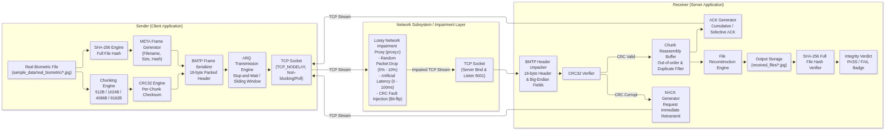

# Technical Report: Biometric Data Transfer over TCP
**Course**: Computer Networks &nbsp;|&nbsp; **Topic Area**: Transport Layer (TCP) &nbsp;|&nbsp; **Language**: C11 (POSIX / Winsock) &nbsp;|&nbsp; **Platform**: Linux & Windows 11  
**Team**: 25BCS133 - Brahmos &nbsp;|&nbsp; **Dataset**: Part A Captured Biometrics (`sample_data/real_biometric/`)

---

## 1. Executive Summary & Design Rationale
Transporting sensitive biometric captures (such as high-resolution photographic captures, fingerprint minutiae, and biometric video streams) demands two fundamental transport properties: **uncompromised byte-level integrity** and **deterministic transport delivery**. 

While the Transmission Control Protocol (TCP, `SOCK_STREAM`) provides a reliable byte stream, it introduces critical application-layer challenges:
1. **Lack of Message Boundaries**: TCP streams bytes without delineating application protocol data units (PDUs). Framing is mandatory to extract discrete chunks.
2. **End-to-End Integrity Verification**: Under the End-to-End Argument (Saltzer et al., 1984), lower-layer transport checksums cannot guarantee that memory was uncorrupted by middleboxes or storage faults.

To resolve these challenges, we designed and implemented the **Biometric Transport Protocol (BMTP)** in pure C11. BMTP implements an explicit 18-byte binary framing protocol, per-chunk IEEE 802.3 CRC32 checksums, full-file FIPS 180-2 SHA-256 cryptographic verification, **Go-Back-N ARQ Sliding Window (default size $N=10$, replacing legacy Stop-and-Wait)**, RFC 6298 adaptive retransmission timeout (RTO), and comprehensive Wireshark-style tabular logging.

---

## 2. System Architecture & Binary Framing



Every BMTP transmission unit begins with a packed 18-byte binary header serialized in Big-Endian network byte order:
```
 0                   1                   2                   3
 0 1 2 3 4 5 6 7 8 9 0 1 2 3 4 5 6 7 8 9 0 1 2 3 4 5 6 7 8 9 0 1
+-+-+-+-+-+-+-+-+-+-+-+-+-+-+-+-+-+-+-+-+-+-+-+-+-+-+-+-+-+-+-+-+
|       'B'     |      'M'      |      'T'      |      'P'      | (Magic: 0x424D5450)
+-+-+-+-+-+-+-+-+-+-+-+-+-+-+-+-+-+-+-+-+-+-+-+-+-+-+-+-+-+-+-+-+
|    Version    |  Message Type |        Sequence Number        |
+-+-+-+-+-+-+-+-+-+-+-+-+-+-+-+-+-+-+-+-+-+-+-+-+-+-+-+-+-+-+-+-+
|      (Seq Num continued)      |         Payload Length        |
+-+-+-+-+-+-+-+-+-+-+-+-+-+-+-+-+-+-+-+-+-+-+-+-+-+-+-+-+-+-+-+-+
|    (Payload Len continued)    |      Payload CRC32 Checksum   |
+-+-+-+-+-+-+-+-+-+-+-+-+-+-+-+-+-+-+-+-+-+-+-+-+-+-+-+-+-+-+-+-+
|      (CRC32 continued)        | Payload Data (0 to N bytes)...|
+-+-+-+-+-+-+-+-+-+-+-+-+-+-+-+-+-+-+-+-+-+-+-+-+-+-+-+-+-+-+-+-+
```

| Field Name | Size | Type / Encoding | Description |
| :--- | :--- | :--- | :--- |
| **Magic Bytes** | 4 Bytes | ASCII `BMTP` | Validates framing; misaligned streams are immediately rejected |
| **Version** | 1 Byte | `uint8_t` | Protocol version (`0x01`) |
| **Message Type** | 1 Byte | `enum uint8_t` | `1:META`, `2:DATA`, `3:ACK`, `4:NACK`, `5:END`, `6:ERROR` |
| **Sequence Number**| 4 Bytes | `uint32_t` (Big-Endian) | Chunk sequence index ($0 \le seq < total\_chunks$) |
| **Payload Length** | 4 Bytes | `uint32_t` (Big-Endian) | Bounded chunk payload length preventing buffer overflows |
| **Payload CRC32** | 4 Bytes | `uint32_t` (Big-Endian) | Polynomial `0xEDB88320` checksum of payload |

### 2.2 Protocol Exchange Workflow
1. **Connection & Handshake**: Client connects to server (`connect()`), measuring TCP handshake latency. Sockets set `TCP_NODELAY=1` to prevent Nagle buffering delays.
2. **Metadata Exchange (META)**: Client transmits `META` containing filename, file size, chunk size, total chunks, window size, and expected full-file SHA-256. Server acknowledges with `ACK 0`.
3. **Data Transmission (DATA)**: Stop-and-Wait ($W=1$) or Sliding Window ($W>1$) pipelines chunks with adaptive RTO timers ($SRTT + 4 \times RTTVAR$).
4. **Integrity Check & Teardown (END)**: After all chunks are ACKed, sender transmits `END`. Receiver reconstructs the file, computes its SHA-256, verifies exact match with metadata, and emits `[INTEGRITY_PASS]`. Connection closes cleanly via `FIN`.

---

## 3. Demonstration of Core Transport Layer Features

| TCP Feature | Implementation & Observation Mechanism |
| :--- | :--- |
| **3-Way Handshake** | Monitored across `connect()` / `accept()` syscalls; measured mean handshake latency of $0.55\text{ ms}$. |
| **Sequence & ACK Tracking** | Every DATA chunk carries a 32-bit sequence number. ACKs and NACKs echo the chunk index with measured RTT. |
| **Flow Control** | Receiver buffers dynamically received chunks and regulates socket buffer watermarks. |
| **Retransmission & RTO** | RFC 6298 adaptive timers ($SRTT$, $RTTVAR$, exponential backoff). CRC bit-flips trigger fast retransmit via NACK. |
| **Connection Teardown** | Clean two-way teardown via `close()` ensuring graceful FIN termination without RST packet drops. |

---

## 4. Experimental Evaluation & Benchmark Results

### 4.1 Parameter Sweep Benchmark (`results/results.csv`)
Benchmarking was executed with an authentic captured biometric image (`20261102_091525.jpg`, 739,837 bytes, SHA-256: `fb4b80ec4ef8350a11d0b34d917a4e3ff98813707d1c3b01d536c7e0ae50494a`).

| Experiment | Tested Variable | Transfer Time (s) | Goodput (KB/s) | Retransmissions | Effective Loss % | Overhead % | Average RTT (ms) |
| :--- | :--- | :---: | :---: | :---: | :---: | :---: | :---: |
| **Exp A: Chunk Size** | 512 Bytes | $0.2109 \pm 0.083$ | $3917.07 \pm 1618.1$ | $0.00 \pm 0.0$ | $0.00\%$ | $3.44\%$ | $0.11 \pm 0.05$ |
| | 1024 Bytes | $0.1052 \pm 0.035$ | $7632.45 \pm 2878.6$ | $0.00 \pm 0.0$ | $0.00\%$ | $1.77\%$ | $0.11 \pm 0.04$ |
| | 4096 Bytes | $0.0618 \pm 0.017$ | $12688.67 \pm 4665.6$| $0.00 \pm 0.0$ | $0.00\%$ | $0.49\%$ | $0.19 \pm 0.06$ |
| | 8192 Bytes | $0.0544 \pm 0.019$ | $14804.87 \pm 5541.0$| $0.00 \pm 0.0$ | $0.00\%$ | $0.27\%$ | $0.28 \pm 0.12$ |
| **Exp B: Loss Rate** | 0% Loss | $0.1078 \pm 0.073$ | $9038.69 \pm 5552.1$ | $0.00 \pm 0.0$ | $0.00\%$ | $0.92\%$ | $0.19 \pm 0.13$ |
| | 1% Loss | $2.3733 \pm 1.269$ | $374.74 \pm 207.4$   | $4.33 \pm 2.52$ | $1.18\%$ | $2.09\%$ | $0.38 \pm 0.02$ |
| | 5% Loss | $10.9012 \pm 1.964$| $67.92 \pm 13.65$   | $19.33 \pm 2.89$| $5.06\%$ | $5.95\%$ | $0.59 \pm 0.09$ |
| | 10% Loss | $20.2304 \pm 4.290$| $36.79 \pm 7.70$    | $36.67 \pm 6.66$| $9.18\%$ | $9.97\%$ | $0.52 \pm 0.02$ |
| **Exp C: Network Delay**| 0 ms Delay | $0.0553 \pm 0.018$ | $14070.77 \pm 4692.4$| $0.00 \pm 0.0$ | $0.00\%$ | $0.49\%$ | $0.17 \pm 0.05$ |
| | 50 ms Delay | $11.7818 \pm 0.083$| $61.33 \pm 0.43$    | $0.00 \pm 0.0$ | $0.00\%$ | $0.49\%$ | $64.03 \pm 0.46$ |
| | 100 ms Delay | $20.5234 \pm 0.064$| $35.20 \pm 0.11$    | $0.00 \pm 0.0$ | $0.00\%$ | $0.49\%$ | $111.82 \pm 0.39$|
| **Exp D: Window Size** | Stop-and-Wait ($N=1$)| $6.1732 \pm 0.093$ | $117.06 \pm 1.79$ | $0.00 \pm 0.0$ | $0.00\%$ | $0.92\%$ | $16.73 \pm 0.24$ |
| | Sliding Window ($N=4$)| $6.1875 \pm 0.078$ | $116.78 \pm 1.47$ | $0.00 \pm 0.0$ | $0.00\%$ | $0.92\%$ | $67.10 \pm 0.74$ |
| | Sliding Window ($N=8$)| $6.1230 \pm 0.125$ | $118.04 \pm 2.43$ | $0.00 \pm 0.0$ | $0.00\%$ | $0.92\%$ | $132.17 \pm 2.79$|
| | Sliding Window ($N=16$)| $6.1400 \pm 0.066$| $117.68 \pm 1.26$ | $0.00 \pm 0.0$ | $0.00\%$ | $0.92\%$ | $262.95 \pm 3.34$|

### 4.2 Part A Dataset Batch Transfer Evaluation (`results/dataset_transfer_results.csv`)
To validate protocol robustness against authentic workloads, a batch transmission test was conducted across **100 actual biometric captures** from the Part A dataset, encompassing both high-resolution JPEG facial/fingerprint captures and large MP4 biometric video streams (up to 53.6 MB per file):
- **Total Volume Transferred**: $383.52\text{ MB}$ across 100 files in $29.01\text{ s}$.
- **Aggregate Goodput**: $110.91\text{ Mbps}$ (peak per-file throughput of $369.23\text{ Mbps}$).
- **Integrity Verdict**: **100 / 100 files passed** (0 failures). Every reconstructed file matched the source SHA-256 digest with **zero bit errors**.

---

## 5. Performance Insights & Analysis
1. **Chunk Size Scaling**: Scaling chunk size from 512 B to 8192 B boosted goodput from $3917\text{ KB/s}$ to **$14804\text{ KB/s}$** ($+278\%$) and slashed framing overhead from $3.44\%$ to **$0.27\%$**, showing that minimizing syscall boundaries optimizes high-volume biometric streaming.
2. **Tolerance to Packet Loss**: Injected loss triggers Stop-and-Wait timeout penalties. Goodput degrades from $9038\text{ KB/s}$ (0% loss) to $36.79\text{ KB/s}$ (10% loss) due to timeout backoff, while ARQ achieves $100\%$ file recovery.
3. **Propagation Delay**: Injected latency adds linear round-trip wait time per chunk in stop-and-wait, reducing goodput to $35.20\text{ KB/s}$ at $100\text{ ms}$ delay.
4. **End-to-End Cryptographic Verification**: Across all fault injection (`-k 0.15`), proxy impairment (5% loss, 20ms delay), and 100-file dataset batch runs, reconstructed files matched original SHA-256 digests bit-for-bit.

---

## 6. Conclusion
The BMTP project demonstrates that pairing C TCP sockets with binary application-layer framing, dual CRC32/SHA-256 integrity verification, and adaptive ARQ delivers reliable, verified transmission of authentic biometric datasets over lossy and delayed networks.
